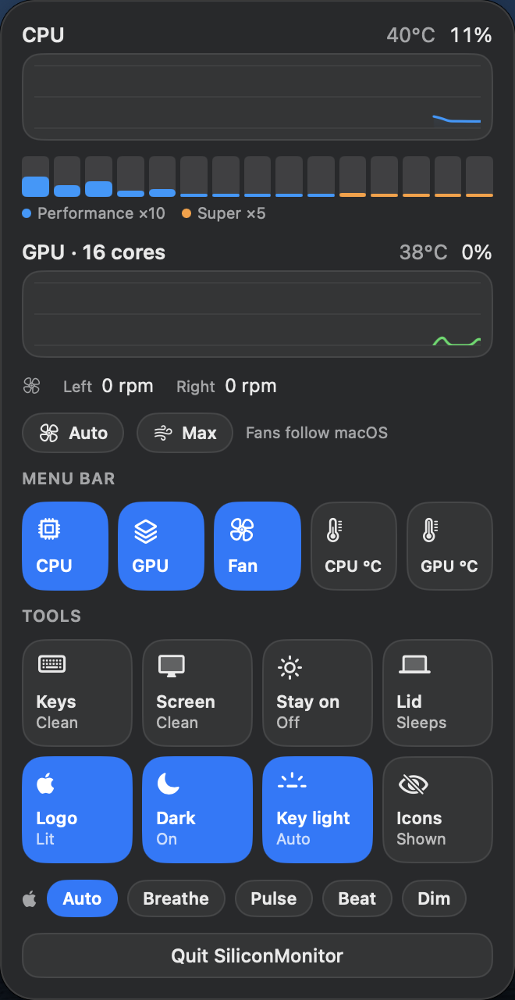

# SiliconMonitor

A menu bar monitor and toolbox for Apple Silicon MacBook Pros: live CPU and GPU load, per-core CPU bars,
temperatures and fan speed, **manual fan control**, plus a handful of one-tap tools, including control of the
**glowing Apple logo** on the newer MacBook Pros that have one.

<p align="center"></p>

Written in Swift/SwiftUI with the Swift Package Manager. It builds from the command line, so **no Xcode is needed**,
only the Command Line Tools.

> **Read this first.** SiliconMonitor talks to the SMC and to private, undocumented macOS interfaces, and its fan control
> uses a small background helper that runs as root. It was built and tested on **one machine**: a MacBook Pro
> (`Mac17,13`, M5 Pro) on macOS 27.2. Other Macs may report different sensors, and a macOS update can break the
> private interfaces at any time. Fan control can affect your Mac's temperatures. You use it at your own risk (see the
> [license](LICENSE) and [Safety](#safety)).

## Features

**Monitoring**
- CPU and GPU load as 1-minute rolling graphs, plus one bar per CPU core, colored by core tier
- CPU and GPU temperature, and the speed of each fan
- Disk: remaining storage on the startup volume (read and write speed in the tooltip)
- Battery health and charge cycle count
- Network download and upload speed, and the power the whole Mac is drawing (watts)
- RAM used and memory pressure (normal, warning, critical)
- Choose what appears in the menu bar: CPU, GPU, fan speed, CPU temp, GPU temp, free disk space (fixed-width text, so it doesn't jitter)

**Fan control**
- Auto (macOS decides), Manual with a slider from each fan's minimum to maximum speed, or **Max**
- Needs one admin password, once, to install the helper (see [Fan control and the helper](#fan-control-and-the-helper))

**Tools** (one tap each)
- **Keys**: lock the keyboard while you clean it (auto-releases after 5 minutes)
- **Screen**: black out every display for cleaning (Esc or 2 minutes ends it)
- **Stay on**: keep the display from sleeping
- **Lid**: stay awake with the lid closed (`pmset disablesleep`, run by the helper, so no password prompt after the one-time install; it reverts if the app quits or crashes)
- **Logo**: the glowing Apple logo, on or off, with **Breathe**, **Pulse**, **Beat** and **Dim** modes
  (MacBook Pro with a PROLED XDR display only; the tile doesn't appear on other Macs)
- **Dark**: dark or light appearance
- **Key light**: keyboard backlight, cycling Auto (ambient sensor), On (fixed level), Off
- **Icons**: hide or show the desktop icons (restarts Finder)

## Requirements

- macOS 14 or later, Apple Silicon (M-series)
- Command Line Tools (`xcode-select --install`), which include Swift
- Some tiles only appear when the hardware exists (Logo, Key light)

## Download

Grab the latest **`SiliconMonitor-x.y.dmg`** from the [Releases](https://github.com/DaGarlic/SiliconMonitor/releases)
page, open it and drag **SiliconMonitor** onto **Applications**. No Xcode or Command Line Tools needed.

The app isn't notarized by Apple, so macOS blocks the first launch ("cannot be opened because the developer cannot be
verified"). To open it anyway, use either of these once:

- Open **System Settings › Privacy & Security**, scroll down and click **Open Anyway**, or
- run `xattr -dr com.apple.quarantine /Applications/SiliconMonitor.app` in Terminal.

## Build and run

```sh
git clone https://github.com/DaGarlic/SiliconMonitor.git
cd SiliconMonitor
./bundle.sh          # builds, creates SiliconMonitor.app and signs it
open SiliconMonitor.app
```

The app has no Dock icon; look for it in the menu bar. Click the readout to open the card.

### Keeping permissions between rebuilds (optional)

Keyboard cleaning needs **Accessibility** and **Input Monitoring** access (System Settings › Privacy & Security).
macOS ties those permissions to the app's code signature, and by default `bundle.sh` signs ad hoc, so the signature
(and the permission) changes on every rebuild. To avoid re-granting after each build, create a local self-signed
identity once:

```sh
./tools/create_signing_identity.sh
```

`bundle.sh` signs with it automatically when it exists. The script only adds one certificate to your login keychain
and changes no trust settings.

## Updating

**From the DMG:** quit SiliconMonitor (Quit button in the card), download the newer `.dmg`, and drag the app onto
**Applications**, choosing **Replace**. Then open it again.

**From source:**

```sh
cd SiliconMonitor
git pull
./bundle.sh
```

Quit the running copy and open the new `SiliconMonitor.app` (or copy it over the one in Applications).

Things to expect after an update:

- **The fan helper updates itself.** If a new version changes how the app talks to the helper, the app asks for your
  admin password once, the first time you use fan control or the Lid tool, and reinstalls it. Otherwise nothing happens.
- **Permissions may need granting again.** macOS ties Accessibility and Input Monitoring (keyboard cleaning) to the
  app's code signature, and downloaded builds are signed ad hoc, so each new version can look like a new app. If Keys
  stops working, remove SiliconMonitor from those two lists in **Privacy & Security** and add it again.
- **Your settings are kept** (menu bar choices, fan percentage and so on).

To remove the app completely, quit it, delete it from Applications, and run `./tools/uninstall_fan_helper.sh` if you
ever installed the fan helper.

## Making a release (maintainers)

```sh
./tools/make_dmg.sh 1.1          # builds SiliconMonitor-1.1.dmg (version number is optional)
gh release create v1.1 SiliconMonitor-1.1.dmg --title "SiliconMonitor 1.1" --notes "What changed"
```

`make_dmg.sh` runs `bundle.sh` with that version, packs the app with an Applications shortcut, and verifies the image.
Because the app uses private macOS interfaces and is not notarized, it can't go through the Mac App Store.

## Fan control and the helper

Writing the fan keys (and `pmset disablesleep` for the Lid tool) needs root. The first time you use either, the app asks
for your admin password and installs a small helper:

- `/Library/PrivilegedHelperTools/local.siliconmonitor.fanhelper` (a root-owned copy of the app's own binary)
- `/Library/LaunchDaemons/local.siliconmonitor.fanhelper.plist`

It listens on a Unix socket (`/var/run/local.siliconmonitor.fan.sock`) and **only accepts connections from the user
that installed it** (checked with the peer's real uid). It can only set fan speeds and switch lid-closed sleep on or off. After the one-time install there
are no more password prompts. To remove it:

```sh
./tools/uninstall_fan_helper.sh
```

### Safety

The helper puts the fans back on automatic whenever:

- you switch back to Auto, quit the app, or the app crashes (the connection closes),
- the app stops sending its heartbeat for 10 seconds,
- the helper process is stopped, or
- the chip reaches **95 °C** while in manual mode (it then refuses manual control until it cools to 85 °C).

The slowest manual speed is each fan's own minimum (2000 rpm on the tested machine). Manual mode can't turn the fans
off, but a low manual speed under heavy load means they won't ramp up by themselves, so don't leave it there.

## The Apple logo

macOS has no public API for the logo. Apple's documented way to turn it off is a `sudo defaults write` command. This
app instead talks to the system's own brightness daemon through the private `CoreBrightness` framework
(`BrightnessSystemClient`), using the property names and the fade technique documented by
[LogoLight](https://github.com/Ark0N/LogoLight) (MIT). The code here is an independent implementation. In short:

- on/off is the `LEBacklightMode` property;
- there is no brightness property, so **Dim** starts a fade and reverses it when it reaches the level you chose, which
  holds the logo there; **Breathe**, **Pulse** and **Beat** are sequences of timed fades that reverse at a floor, so the
  logo never goes fully dark;
- every fade also dims the keyboard backlight, so the keyboard is re-lit after each one;
- quitting the app returns the logo to Apple's automatic behavior.

See the header comment in [`LogoControl.swift`](Sources/SiliconMonitor/LogoControl.swift) for details.

## Debug options

```sh
.build/release/SiliconMonitor --dump                 # print one reading of CPU/GPU/temps/fans and exit
.build/release/SiliconMonitor --keys F               # list SMC keys starting with F (read-only)
.build/release/SiliconMonitor --logo-selftest        # run each logo mode and print the logo's level (animates the logo)
.build/release/SiliconMonitor --tools-selftest       # round-trip dark mode and keyboard backlight (flashes the screen)
.build/release/SiliconMonitor --install-fan-helper   # run the one-time helper install from a shell
SILICONMONITOR_SHOW_CARD=1 open ...                  # open the card at launch (handy for screenshots)
```

## Project layout

| Path | What it is |
|---|---|
| `Sources/CSMC` | Tiny C wrapper around the AppleSMC user client (the struct layout has to match exactly) |
| `Sources/SiliconMonitor/Monitor.swift` | CPU, GPU, temperature and fan readings, rolling history |
| `Sources/SiliconMonitor/Card.swift` | The rounded, borderless menu bar card |
| `Sources/SiliconMonitor/SiliconMonitorApp.swift` | App delegate, status item and all the views |
| `Sources/SiliconMonitor/FanControl.swift`, `FanHelper.swift` | Fan control: app side and root helper |
| `Sources/SiliconMonitor/LogoControl.swift` | Apple logo control |
| `Sources/SiliconMonitor/SystemTools.swift` | Dark mode, keyboard backlight, desktop icons |
| `Sources/SiliconMonitor/Cleaning.swift`, `PowerMode.swift` | Keyboard and screen cleaning, keep-awake |
| `bundle.sh` | Builds and signs `SiliconMonitor.app` |
| `tools/make_dmg.sh` | Packs the app into a downloadable `.dmg` |
| `tools/` | Icon generator, signing-identity, DMG and uninstall scripts |

## Known limitations

- Only tested on a single MacBook Pro. Sensor and fan key names can differ on other models.
- macOS exposes no per-core GPU load, so the GPU shows whole-GPU numbers only.
- The logo, key light and dark mode use private interfaces and may stop working after a macOS update.
- The fan helper is a copy of the app binary made at install time; if the protocol changes, the app reinstalls it
  (one more password prompt).

## Credits and license

- Logo fade technique and property names: [LogoLight](https://github.com/Ark0N/LogoLight) by Ark0N (MIT).
- Released under the [MIT License](LICENSE).
- Not affiliated with or endorsed by Apple. "Apple", "MacBook Pro" and the Apple logo are trademarks of Apple Inc.
